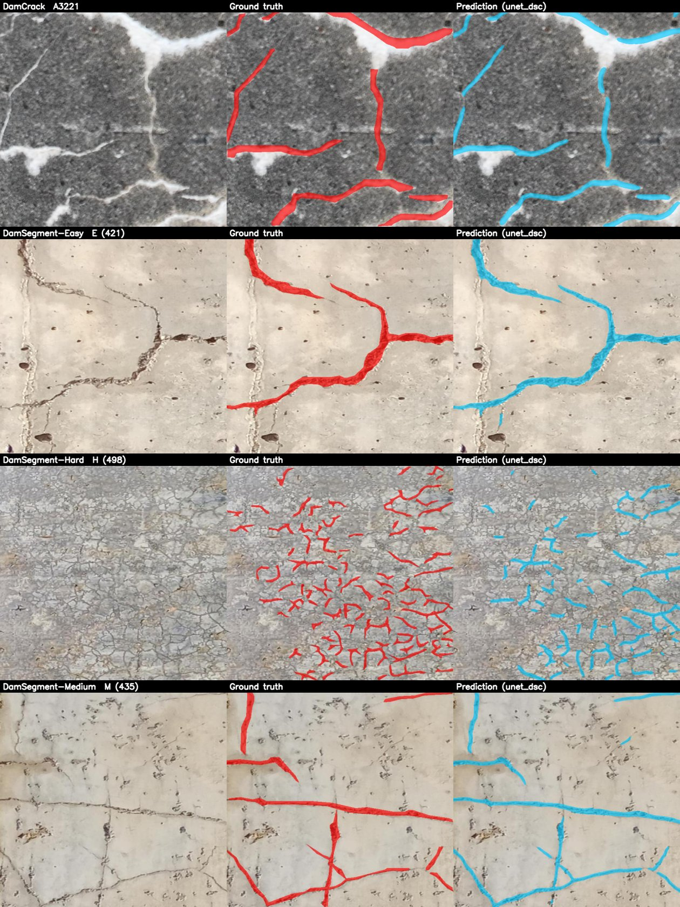
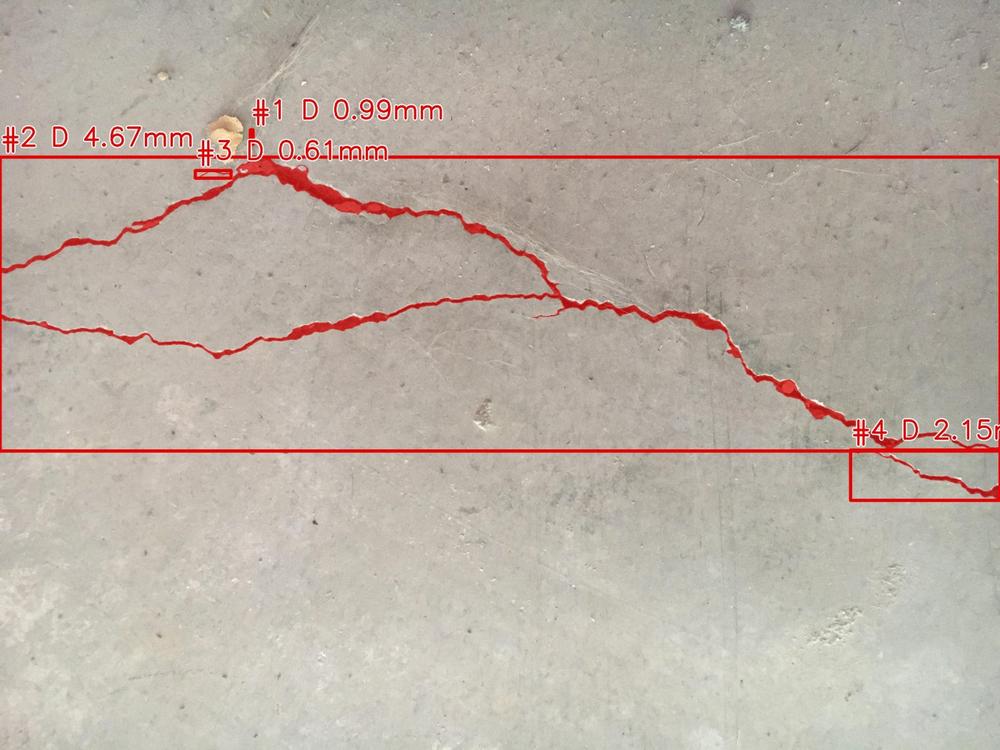

# 大坝混凝土裂缝智能检测与毫米级量化

面向水电站大坝无人机巡检的混凝土表面裂缝检测系统：**像素级分割 → 骨架化量化长度/宽度 → 基于摄影测量 GSD 换算毫米 → 按规范宽度阈值初判等级 → 自动生成巡检报告**。

针对大坝裂缝"极细、细长蜿蜒、易断裂、背景干扰多、影像分辨率高"的特点，在 U-Net 基础上引入：

- **条状池化 Strip Pooling**：沿行 / 列（1×W、H×1）聚合长距离上下文，补全低对比度造成的断点（在公开数据上有效，大坝数据上无明显增益，见消融）；
- **动态蛇形卷积 DSConv**：采样点沿 x/y 方向连续累积偏移，自适应贴合蜿蜒的管状结构（大坝测试集 F1 +2.0、最难子集 +5.4 个点，断裂段数 −7%）；
- **clDice 拓扑损失 + Dice/Focal**：约束中心线连续性，缓解极度类别不平衡；
- **重叠切片 + 余弦权重融合**：支持 4000×3000 以上的无人机原图，保持原始分辨率；
- **结构张量 + 正交剖面亚像素测宽**：在合成数据上宽度误差 1.6%，长度误差 0.2%。

## 技术路线

```
无人机贴近摄影（按目标 GSD 设计物距）
   │
   ├─► 三维重建 / 正射影像（ContextCapture / Metashape / COLMAP 等成熟软件，用于定位与多期对比）
   │
   └─► 原始影像 ─► 重叠切片 ─► U-Net + StripPooling + DSConv ─► 融合概率图
                                                                │
              形态学后处理 ◄────────────────────────────────────┘
                   │
         骨架化 + 结构张量切线方向
                   │
     正交剖面亚像素测宽 / 方向加权弧长 ── × GSD ──► 长度、宽度(mm)
                   │
      规范阈值初判等级（A/B/C/D）+ 疑似结构缝标记 ──► 标注图 + Excel 巡检报告
```

## 实验结果

完整表格见 [docs/results.md](docs/results.md)（由 `scripts/summarize.py` 生成）。

<!-- RESULTS -->
### 1. 真实大坝数据消融（测试集 1104 张，3 个随机种子 均值±标准差）

| 方法 | P | R | F1 | IoU | clDice | Frag ↓ | Hard 子集 F1 |
|---|---|---|---|---|---|---|---|
| U-Net（BCE）基线 | 0.763 | 0.596 | 0.669±0.003 | 0.503 | 0.714 | 1.247 | 0.550 |
| + Dice/Focal/clDice 损失 | 0.685 | 0.687 | 0.686±0.007 | 0.522 | 0.705 | 1.187 | 0.594 |
| + 条状池化 SP | 0.698 | 0.675 | 0.686±0.003 | 0.522 | 0.701 | 1.186 | 0.598 |
| **+ 蛇形卷积 DSC** | 0.674 | 0.705 | **0.689±0.002** | **0.526** | 0.690 | **1.159** | **0.604** |
| + SP + DSC | 0.687 | 0.679 | 0.683±0.001 | 0.519 | 0.695 | 1.175 | 0.589 |

Frag = 每条真实裂缝被预测成几段（越接近 1 越连续）。

- **损失函数贡献最大**：Dice/Focal/clDice 使 F1 +1.7 个点、召回率 +9 个点（BCE 偏保守，漏检细缝）。
- **蛇形卷积最优**：相比基线 F1 +2.0 个点、断裂段数 −7%，在龟裂密集的 DamSegment-Hard 上 F1 +5.4 个点。
- **条状池化在大坝数据上无明显增益**，与 DSC 叠加反而略降。可能原因：640×640 切片内裂缝较短、Hard 子集以网状龟裂为主，行/列方向的长条上下文帮助有限；且坝面分层施工缝、模板缝恰好沿水平/竖直方向，条状池化可能放大了这类干扰。因此推荐配置为 `unet_dsc`。

### 2. 迁移实验：公开混凝土数据 → 大坝

| 设置 | 大坝训练数据 | F1 |
|---|---|---|
| 零样本（DeepCrack / Özgenel 训练，直接测大坝） | 0 | 0.19 ~ 0.25 |
| 少样本，ImageNet 初始化 | 10%（385 张） | 0.659 |
| 少样本，Özgenel 模型初始化 | 10% | 0.654 |
| 全量，ImageNet 初始化 | 100% | 0.681 |
| 全量，Özgenel 模型初始化 | 100% | 0.685 |

（模型均为 SP+DSC，种子 0）

- **公开数据训练的模型不能直接用于大坝**（F1 仅约 0.2）：析钙、渗水痕、施工缝等大坝特有干扰造成明显的领域差异。
- **只需少量本坝标注**：10% 数据即可达到全量训练 97% 的效果，对应工程上"新坝标注几百张即可上线"。
- 公开裂缝数据预训练带来的增益很小（≤0.4 个点），ImageNet 预训练已足够。

### 3. 公开数据集（单种子）

| 方法 | DeepCrack F1 | DeepCrack Frag ↓ | Özgenel F1 | Özgenel Frag ↓ |
|---|---|---|---|---|
| 传统方法（CLAHE + 黑帽 + Otsu） | 0.145 | 2.13 | 0.079 | 5.85 |
| U-Net（BCE） | 0.826 | 1.89 | 0.894 | 4.47 |
| + Dice/Focal/clDice | 0.837 | 1.51 | 0.898 | 1.79 |
| + 条状池化 SP | 0.842 | 1.47 | 0.906 | 1.87 |
| + 蛇形卷积 DSC | 0.840 | **1.39** | 0.905 | **1.59** |
| + SP + DSC | 0.842 | 1.40 | 0.905 | 1.79 |

在 4032×3024 高分辨率影像上，DSC 将断裂段数从 4.47 降到 1.59（−65%），连通域个数误差从 19.6 降到 5.6（−71%）。
<!-- /RESULTS -->

量化算法的合成数据验证见 [docs/quantify_validation.md](docs/quantify_validation.md)。

### 4. 可视化

大坝测试集（左：原图，中：人工标注，右：`unet_dsc` 预测）。模型未将析钙白斑、气孔误判为裂缝，长缝预测基本连续：



巡检推理输出示例（4032×3024 原图，切片推理 → 量化 → 分级）。图中 GSD 按假设的手机相机参数与 0.3 m 物距计算（约 0.1 mm/px），毫米数值仅用于演示流程：



## 数据

**主实验：真实混凝土大坝数据**（Gharehbaghi et al., *Data in Brief* 2026，CC BY 4.0）

| 数据集 | 规模 | 说明 |
|---|---|---|
| [DamCrack](https://zenodo.org/records/17274707) | 4000 张，640×640 | 运行中的混凝土坝，无人机（含自主航线）+ 手机拍摄；含析钙、渗水痕、分层施工缝、水面反光等真实干扰 |
| [DamSegment](https://data.mendeley.com/datasets/z5z6gtt5t4/1) | 1500 张，640×640 | 混凝土坝，按难度分 Easy / Medium / Hard（含大量龟裂） |

掩膜中红色为裂缝、蓝色为剥落；本项目做裂缝分割，剥落视为背景。相邻编号的切片可能来自同一原图，
因此按编号**连续分段**划分 70/10/20（测试集相当于未见过的坝段），避免训练/测试泄漏。

**迁移实验 / 预训练：公开混凝土裂缝数据**

| 数据集 | 规模 | 说明 |
|---|---|---|
| [DeepCrack](https://github.com/yhlleo/DeepCrack) | 300 训练 / 237 测试，544×384 | 混凝土表面裂缝 |
| [Concrete Crack Segmentation (Özgenel)](https://data.mendeley.com/datasets/jwsn7tfbrp) | 458 张，4032×3024 | 高分辨率墙面，裂缝像素仅占约 0.5%~1%，用于验证大图切片推理 |

## 使用

```bash
pip install torch timm albumentations opencv-python scikit-image pandas openpyxl scipy
```

数据默认放在 `G:/Dam_crack_data`（可用环境变量 `CRACK_DATA_ROOT` 修改）：

```bash
python scripts/prepare_ozgenel.py                    # 高分辨率数据集解码缓存 + 划分
python train.py --dataset dam --model unet_dsc --loss combo           # 大坝数据（推荐配置）
bash scripts/run_dam.sh                              # 大坝消融 + 迁移实验
bash scripts/run_ablation.sh                         # 全部消融实验
python scripts/baseline_traditional.py               # 传统图像处理基线
python scripts/summarize.py                          # 汇总结果表
python scripts/validate_quantify.py                  # 量化算法精度验证
```

巡检推理（输出标注图、掩膜和 `巡检报告.xlsx`）：

```bash
python infer.py --input <图片或文件夹> --weights <best.pt> --model unet_dsc \
    --pixel_um 4.4 --focal_mm 35 --distance_m 1.0      # 或直接 --gsd 0.12
```

## 目录

```
crackseg/
  models.py      U-Net(ResNet34) 及 SP / DSC 变体
  modules.py     StripPooling、DSConv、DSCBlock
  losses.py      BCE / Dice / Focal / clDice
  metrics.py     P/R/F1/IoU/ODS/OIS + clDice/Frag/β0 连续性指标
  tiling.py      大图重叠切片推理
  quantify.py    骨架、正交剖面测宽、GSD、分级
train.py         训练 + 验证选模 + 测试
infer.py         巡检推理与报告
scripts/         数据准备、消融、基线、汇总、验证
docs/            结果与说明
```

## 局限

- 图像法只能测表面缝宽，规范分级还需缝深（超声等无损检测），因此本项目给出的是**初判等级**；分级阈值请对照 SL 713-2015 原文复核。
- 宽度测量要求裂缝在图上约 ≥2 像素，需通过航线设计保证 GSD。
- DamCrack / DamSegment 的标注是较粗的多边形，普遍宽于真实缝宽，模型学到的掩膜也偏宽；数据集也没有拍摄距离和相机参数。因此大坝数据只评估分割，毫米级宽度需要精细标注的本坝影像 + 已知 GSD 才能验证。
- 施工缝 / 伸缩缝仅做规则标记，后续可增加结构缝类别或结合设计图纸。
- 三维模型反投影定位尚未实现。

## 参考

- Hou Q. et al. Strip Pooling: Rethinking Spatial Pooling for Scene Parsing. CVPR 2020.
- Qi Y. et al. Dynamic Snake Convolution based on Topological Geometric Constraints for Tubular Structure Segmentation. ICCV 2023.
- Shit S. et al. clDice – a Novel Topology-Preserving Loss Function for Tubular Structure Segmentation. CVPR 2021.
- Liu Y. et al. DeepCrack: A Deep Hierarchical Feature Learning Architecture for Crack Segmentation. Neurocomputing 2019.
- Özgenel Ç.F. Concrete Crack Segmentation Dataset. Mendeley Data, 2019.
- Gharehbaghi V. et al. DamCrack: A drone and smartphone image dataset for 2D and 3D damage assessment in concrete dams. Data in Brief, 2026.
- Gharehbaghi V. et al. DamSegment: A curriculum-structured image dataset for damage segmentation of concrete dams. Data in Brief, 2026.
